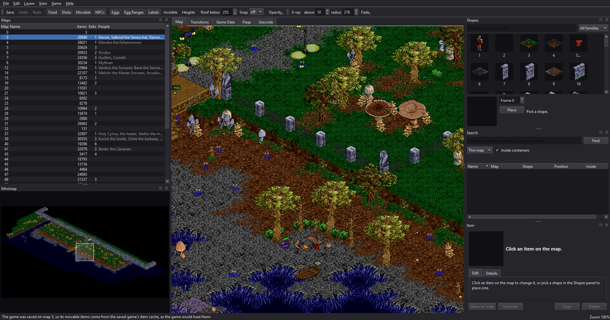
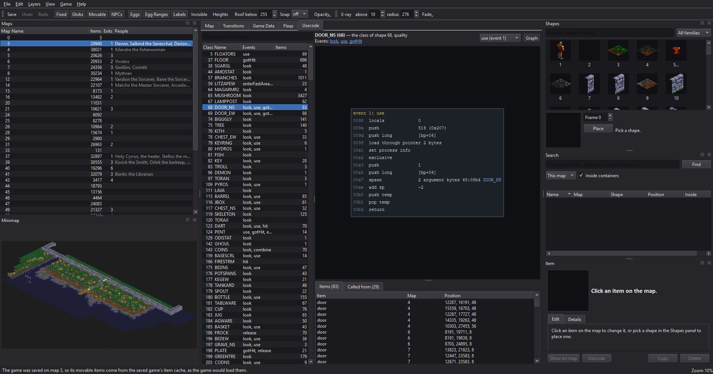
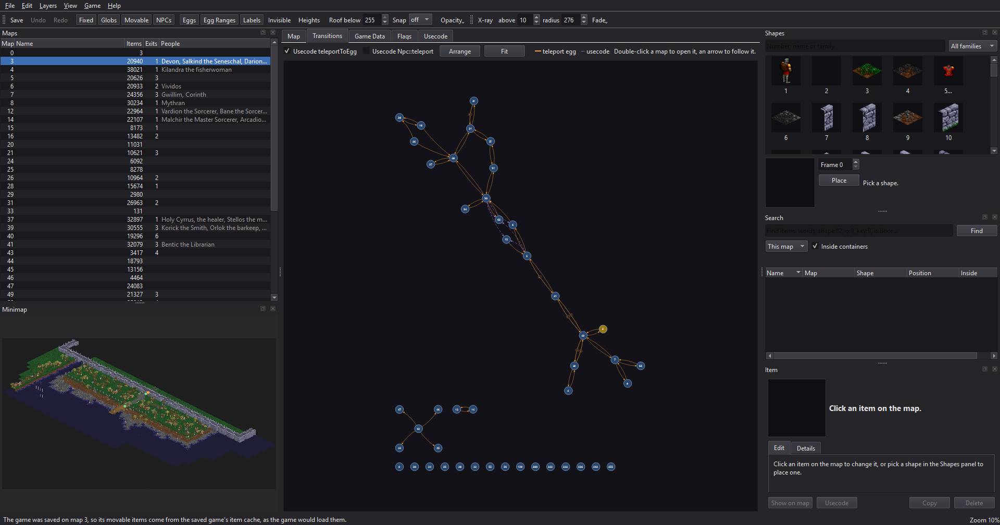
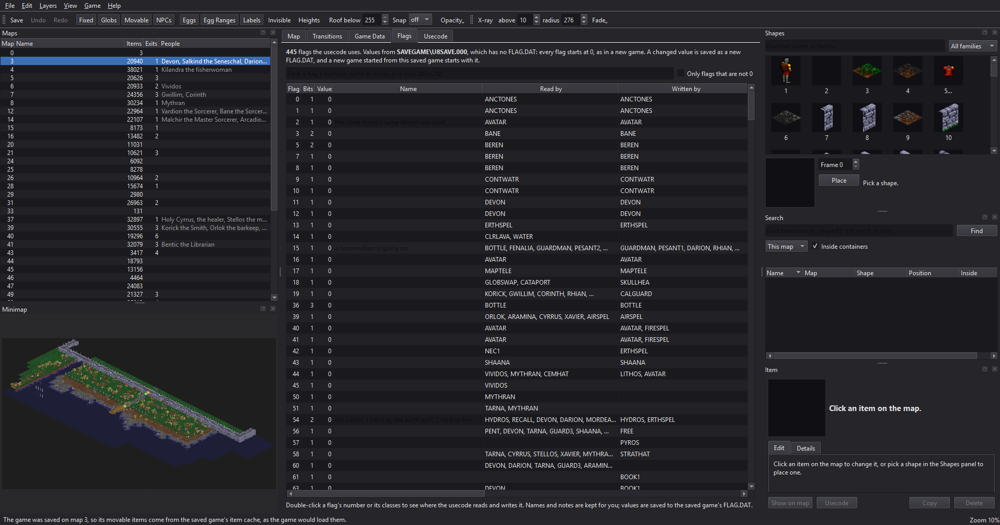
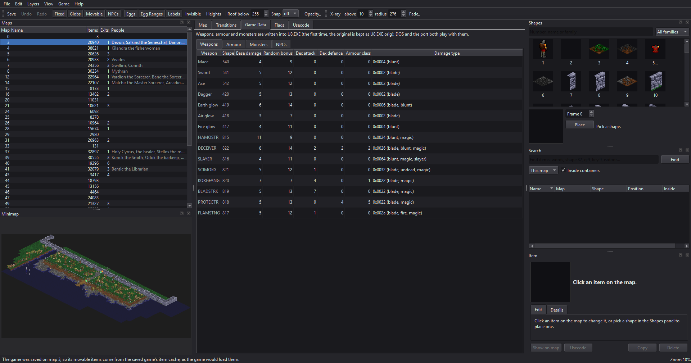

# Ultima 8 Decompile

This is a decompiled source of the Ultima 8 latest retail version, including the english usecode. This build contained some debug symbols which allowed most of the file and function names to be recovered as well. The compiler was Borland C++ 3.0 with a mix of flags. In this decompile the helper libraries (dos extender, etc) were left as binary because they aren't very high value and mostly just assembly anyway. It rebuilds byte-exact minus some debug data at the end of the file.

## Portable port

`ultima8-portable/` is the same source made to build as a modern 64-bit program for Windows,
macOS and Linux, after the Ultima VII portable port: given the game data, it plays Ultima
VIII in a window with emulated MT-32 or AdLib music and Sound Blaster speech and effects.
See [ultima8-portable/README.md](ultima8-portable/README.md) for building and running it, and
[ultima8-portable/PORTING.md](ultima8-portable/PORTING.md) for how it was ported.

## Editor

`ultima8-portable/editor/` is **u8edit**, an editor for the game's world and data, written in
Qt 6. It reads and writes the game's own files the way the game does, so what it saves plays
in DOS U8.EXE as well as in the port. It opens a game folder and a saved game: either
`U8SAVE.000`, which every new game starts from, or a game in progress (`GAMEDAT`).

- **Maps**: every map drawn the way the game draws it. Layers can be turned on and off, eggs
  are shown with where they hatch and what they do, and there is a minimap and a roof cut-off
  for seeing inside buildings. The view can be exported as an image.
- **Items**: select, move, raise, flip, change the frame of, copy and delete items, and place
  new ones from a browser of every shape. Each item's fields can be edited, and eggs are
  explained in plain terms: where a teleport egg leads, which monsters a monster egg makes,
  and so on. A Details tab follows links to an item's container, contents, glob and
  transitions.
- **Names**: an item's name is the one the game shows when the Avatar looks at it. The editor
  gets it by running the item's usecode in a copy of the game's interpreter, so the name
  depends on the item's quality and frame and on the flags in the saved game. It is shown in
  the Item window and in the map's tooltip.
- **NPCs**: where they stand and their statistics (strength, dexterity, intelligence, hit
  points, mana, alignment, flags).
- **Game Data**: the weapon, armour and monster tables, which live inside U8.EXE.
- **Flags**: every global flag the usecode reads or writes (the story's memory), with its value
  in the saved game, the classes and places that use it, and names and notes of your own.
  Changed values are saved to the game's `FLAG.DAT`.
- **Transitions**: a graph of how the maps connect, through teleport eggs and through usecode.
- **Translations**: File > Apply a Translation makes a translated copy of the game. It swaps
  the dialogue and item names, adds the letters the language needs to the fonts, and can leave
  out the English voices so that their lines show as text. Brazilian Portuguese comes with the
  editor.
- **Test in the Port** (F5): saves, then starts the port on a new game made from the edited
  save.
- Every change can be undone, and the first save of a file keeps the original beside it.

*The Map tab on map 3: the maps and minimap on the left, the shape browser, search and Item
window on the right.*

| | |
|---|---|
|  |  |
| *Usecode: a class's code, disassembled, with the items that run it.* | *Transitions: how the maps connect.* |
|  |  |
| *Flags: the story's memory, with the classes that use each flag.* | *Game Data: the tables that live inside U8.EXE.* |

### Limitations

- **Work on a copy of the game folder.** Saving writes into the open folder (the first write of
  each file keeps the original as `name.orig`).
- **Glob items** (the floors and scenery a glob egg puts down) cannot be edited one by one: change,
  move or delete the glob egg, or pick another glob.
- **What NPCs carry** (their inventory) is not editable yet. Their position, frame, flags and
  statistics are.
- **Names are computed, not stored.** They come from running the item's usecode in a copy of the
  interpreter, so a few items fall back to their shape's name or their usecode class.
- **The usecode scan reads bytes, not decoded code**, and keeps only calls whose arguments are all
  constants: transitions made by computed calls are not drawn. The usecode view is read-only; the
  editor does not change usecode.
- **Weapon, armour and monster tables** are found by what editing leaves alone, so they work on the
  retail U8.EXE and may not on a differently patched one.
- **No sound, music or shape/art editing**, and no new maps: it edits the world that is there.
- **Starting maps:** a new game takes the map `U8SAVE.000` was saved on from the save's item cache
  (see the editor README); that map is rebuilt on save, so check edits to it with Test in the Port.
- Built and tested on Windows (MSYS2) and Ubuntu 22.04 (Qt 6.2); macOS has not been tried.

### Planned

- Editing what NPCs carry.
- A faster, more complete usecode scan.

See [ultima8-portable/editor/README.md](ultima8-portable/editor/README.md) for building,
running and using it.

## Downloads

Ready-made builds of the port and the editor for Windows and Linux are on the
[Releases](https://github.com/KarlClinckspoor/Ultima8_DecompPort/releases) page; they need your
own copy of the game. [RELEASING.md](RELEASING.md) says how they are made, and
[CHANGELOG.md](CHANGELOG.md) what each has.

## How the game works

[GAME-MECHANICS.md](GAME-MECHANICS.md): the game's rules as the code implements them:
events and usecode, time and schedules, conversation, quest flags, statistics and how they
grow, and combat, with the formulas.

## Lessons learned

- [DECOMPILATION-LESSONS.md](DECOMPILATION-LESSONS.md): what working on top of the
  decompilation taught: what the source says and what only the rebuilt executable can, and
  how to check what you learn against the game's own data.
- [ultima8-portable/PORT-LESSONS.md](ultima8-portable/PORT-LESSONS.md): how the portable
  version was made, what went wrong, and what to do differently next time.
